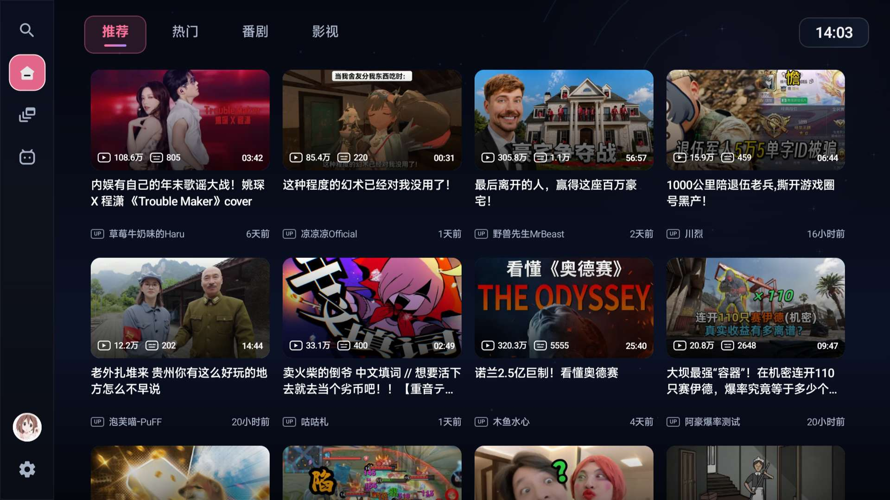
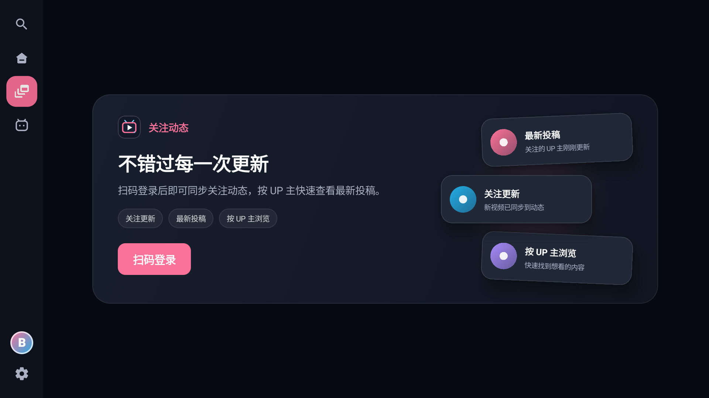
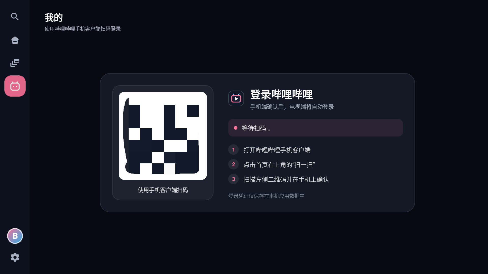
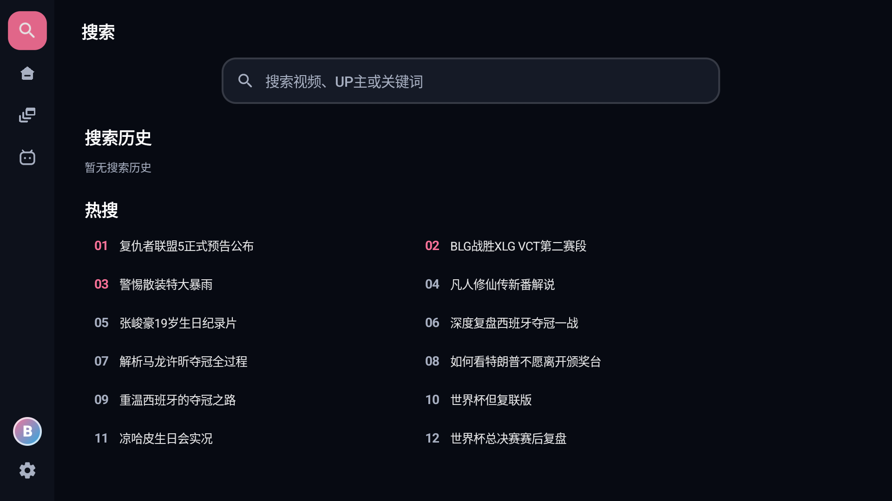
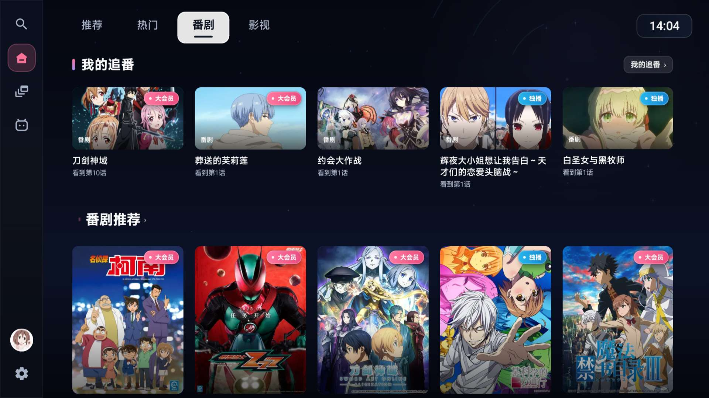
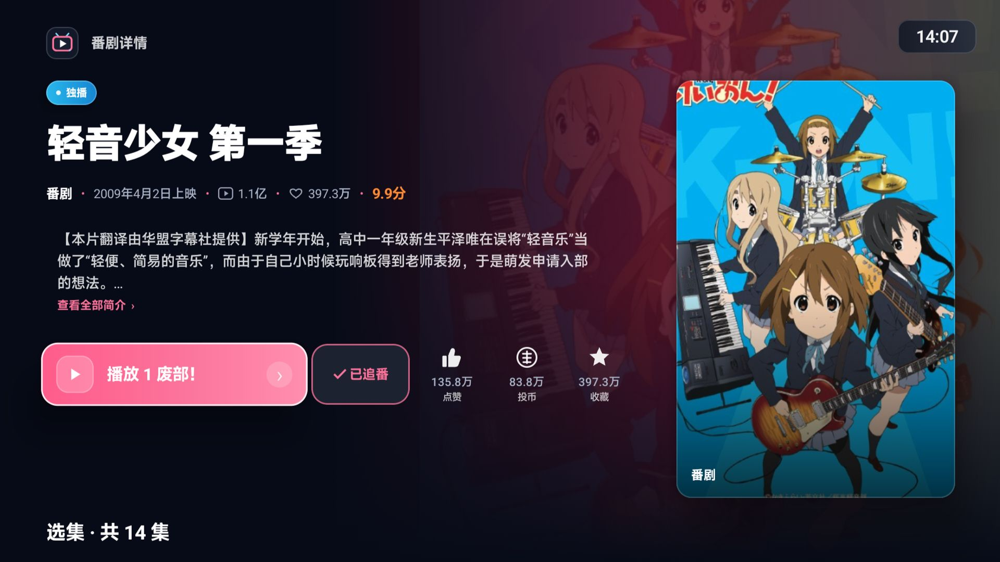
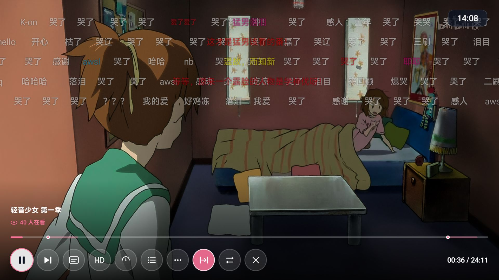

# 📺 BILI Android TV

**BILI 是一个由个人维护的非官方 Android TV 第三方哔哩哔哩客户端，与哔哩哔哩及相关权利方不存在隶属、授权或背书关系。应用免费提供，不包含付费、破解或越权访问功能。当前及后续源代码采用私有闭源方式维护。**

> 注意：本项目不是哔哩哔哩官方客户端，网页端接口可能随时调整；部分影视内容、高清画质和地区限制内容取决于账号权限，请勿分享账号 Cookie。

## ✨ 功能（需要 Android 6.0 及以上）

- 目前已经实现首页的推荐、热门、番剧、影视的视频播放功能
- 支持直播浏览与播放（暂不支持直播弹幕）
- 登录需要用哔哩哔哩官方客户端扫码登录；**登录凭证仅保存在应用私有数据中**
- 登录后支持动态、追番、观看历史、收藏夹、点赞、投币、收藏和关注
- 有搜索功能，索引页、UP 主个人主页、播放历史进度会自动恢复
- 画质跟随 B 站官方，有多高支持多高，前提是大会员账号和电视支持这个画质
- 弹幕基本全覆盖，有彩色、固定、滚动弹幕等，全部可以由你自行设置是否显示
- 弹幕区域/字号/透明度/速度设置也全都拥有，均可自行定义
- 支持字幕功能（**需要这个视频在官方 App 上就有字幕**）
- 影视和番剧拥有官方的自动跳过片头片尾（**需要官方的视频支持跳过**）
- 进度条调节支持精细调控，更准确的调节到你要看的地方
- 支持多账户功能（**点击侧栏的头像即可新增账号**），并且每个账号的设置相互独立，无需担心切换账号后设置丢失
- **如果想要刷新推荐和热门的内容，你只需要将焦点移动到推荐或者热门上，点击确认键即可刷新内容**
- 支持软件内更新，有新版本发布后会收到更新，且能完全在电视上完成更新
- **剩下还有许多的功能需要自行下载软件后去摸索哦~**

## 🖼️ 应用截图

## 🔒 隐私与数据（必看！！！）

- 本应用虽然是闭源，但是不自建服务器，不会把登录 Cookie、搜索历史或本地播放进度上传给我本人或者分享出去。
- 登录 Cookie、设置、搜索历史和本地播放进度等涉及账号隐私的内容仅仅保存在 Android 应用私有目录中。
- 清除账号数据或卸载应用会删除本机登录凭证，清除所有数据。

## 🙏 致谢

本项目的构建优化、网络请求、媒体播放、数据存储、图片加载和二维码能力使用了以下开源项目，感谢原作者和维护者的工作：

- [AndroidX / Jetpack](https://github.com/androidx/androidx)：Jetpack Compose、DataStore、Baseline Profiles 等 Android 基础能力
- [AndroidX Media3](https://github.com/androidx/media)：ExoPlayer 媒体播放与播放器组件
- [OkHttp](https://github.com/square/okhttp)：接口请求、媒体数据源和网络测试工具
- [Kotlinx Serialization](https://github.com/Kotlin/kotlinx.serialization)：接口数据序列化与解析
- [Coil](https://github.com/coil-kt/coil)：Compose 图片加载
- [ZXing](https://github.com/zxing/zxing)：登录和更新页面的二维码生成

以上项目的版权及许可归各自作者所有，本项目按照对应开源许可证使用。

## ⚖️ 闭源维护与版权

- 作者：Yaronluo
- 版权所有：Copyright © 2026 Yaronluo
- APK 公开发布地址：https://github.com/Yaronluo/BILI-For-Android-TV
- 源码维护方式：私有闭源仓库
- 当前及后续版本许可：[Proprietary License](LICENSE)

未经版权所有者事先书面许可，不得复制、修改、公开、再发布或销售当前及后续版本的源代码。

## 💖 最后

如果大家喜欢本项目的话，那就点一个Star吧，这对我继续维护下去提供了动力哦~

此外大家有任何的问题或建议，可以在[问题](https://github.com/Yaronluo/BILI-For-Android-TV/issues)中提出，或者在[讨论](https://github.com/Yaronluo/BILI-For-Android-TV/discussions)中相互讨论

感谢大家使用我的这个软件，你的支持是我继续更新下去的最大动力~
