

# BILI · Android TV

非官方哔哩哔哩 Android TV 客户端

Android 6.0+ · 免费使用 · 多账号 · 私有闭源维护

[下载最新版本](https://github.com/Yaronluo/BILI-For-Android-TV/releases/latest) · [应用截图](#应用截图) · [隐私与自建服务器](#隐私与自建服务器) · [问题反馈](https://github.com/Yaronluo/BILI-For-Android-TV/issues)

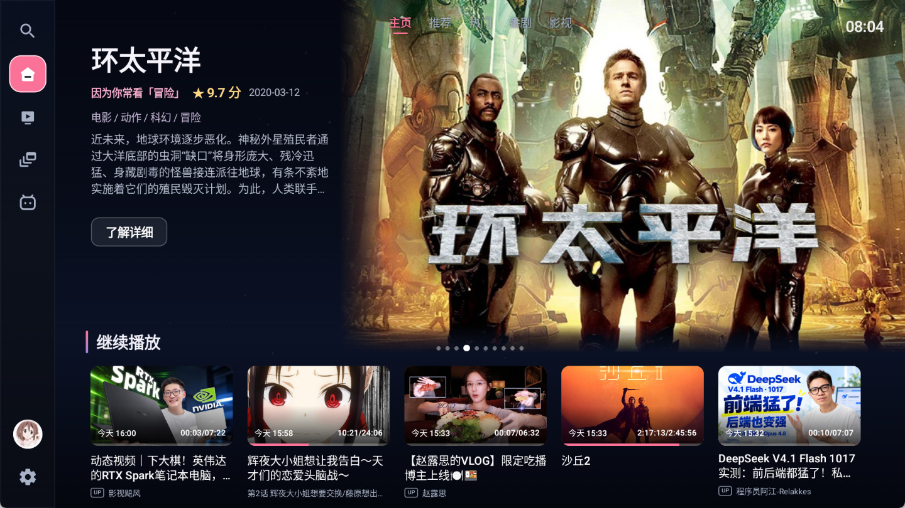

> BILI 由个人维护，与哔哩哔哩及相关权利方不存在隶属、授权或背书关系。应用不包含付费、破解或越权访问功能；内容、清晰度和地区可用性以官方接口、账号权限及设备能力为准。

> **关于自建服务器：** 项目已自建并由开发者运营统计与问题诊断服务，用于了解使用情况、定位故障和改进体验。确认使用须知后，使用统计与质量摘要自动开启，当前无法关闭；完整诊断日志仅在你主动确认后上传。具体数据范围与保留规则见下方[隐私说明](#隐私与自建服务器)。

## ✨ 功能

| 场景 | 可以做什么 |
| :--- | :--- |
| 首页与发现 | 浏览推荐、热门、番剧和影视；通过主页横幅发现内容，从“继续播放”接着看。 |
| 关注与个人内容 | 查看关注动态、UP 主主页、观看历史、追番追剧、稍后再看与收藏夹。 |
| 搜索与索引 | 搜索视频、UP 主和番剧，按索引筛选内容；保留本地搜索历史。 |
| 播放与弹幕 | 切换可用画质与音轨、调整进度，设置滚动／顶部／底部／彩色弹幕，以及区域、字号、透明度和速度。 |
| 字幕与追剧 | 显示官方提供的字幕，按官方提供的范围自动跳过片头片尾。 |
| 多账号与互动 | 用哔哩哔哩官方 App 扫码登录，点击侧栏头像管理账号；支持点赞、投币、收藏和关注，账号与访客的本地数据分别管理。 |
| 直播与更新 | 支持直播浏览、播放与实时弹幕；支持应用内检查和安装更新。 |

使用方向键移动焦点，确认键进入或播放，返回键回到上一页。想换一批推荐或热门内容时，将焦点移到对应顶部标签，再按确认键即可刷新。

## 🖼️ 应用截图

以下为新版界面截图，点击图片可查看大图。动态与个人页面保留了原图中的隐私打码。

### 发现内容

<table>
  <tr>
    <td width="50%" align="center"><a href="docs/readme-images/recommend.jpg">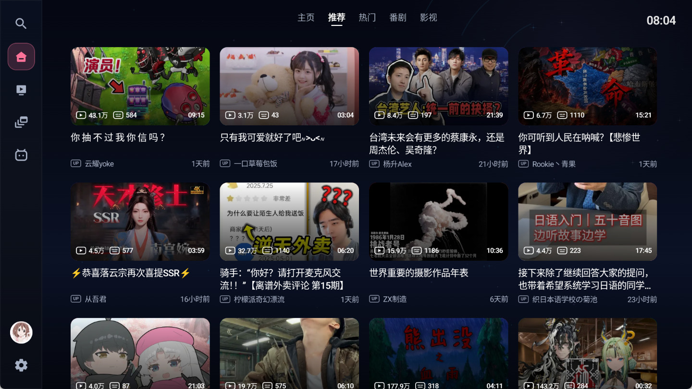</a> <strong>推荐</strong> 浏览感兴趣的视频</td>
    <td width="50%" align="center"><a href="docs/readme-images/popular.jpg">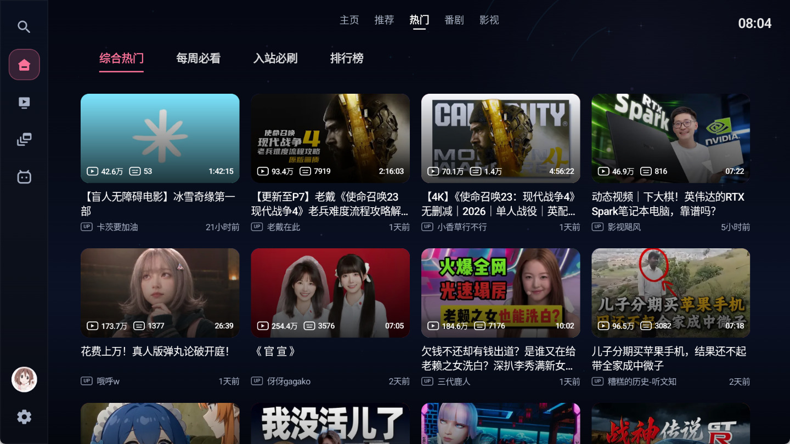</a> <strong>热门</strong> 热门、榜单与每周必看</td>
  </tr>
  <tr>
    <td align="center"><a href="docs/readme-images/bangumi.jpg">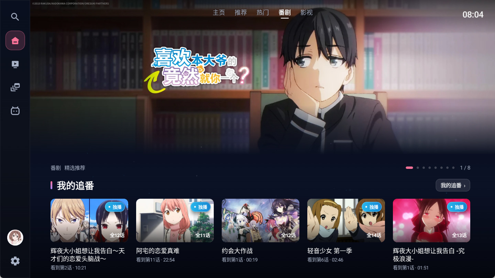</a> <strong>番剧</strong> 新番推荐与我的追番</td>
    <td align="center"><a href="docs/readme-images/cinema.jpg">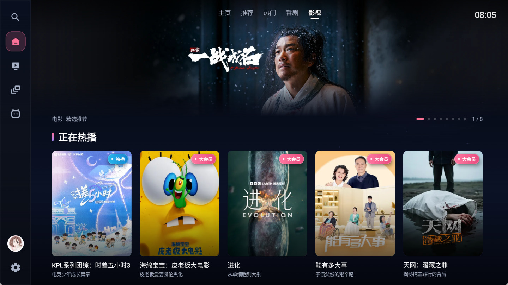</a> <strong>影视</strong> 电影、剧集与正在热播</td>
  </tr>
</table>

### 搜索、直播与关注

<table>
  <tr>
    <td width="50%" align="center"><a href="docs/readme-images/search.jpg">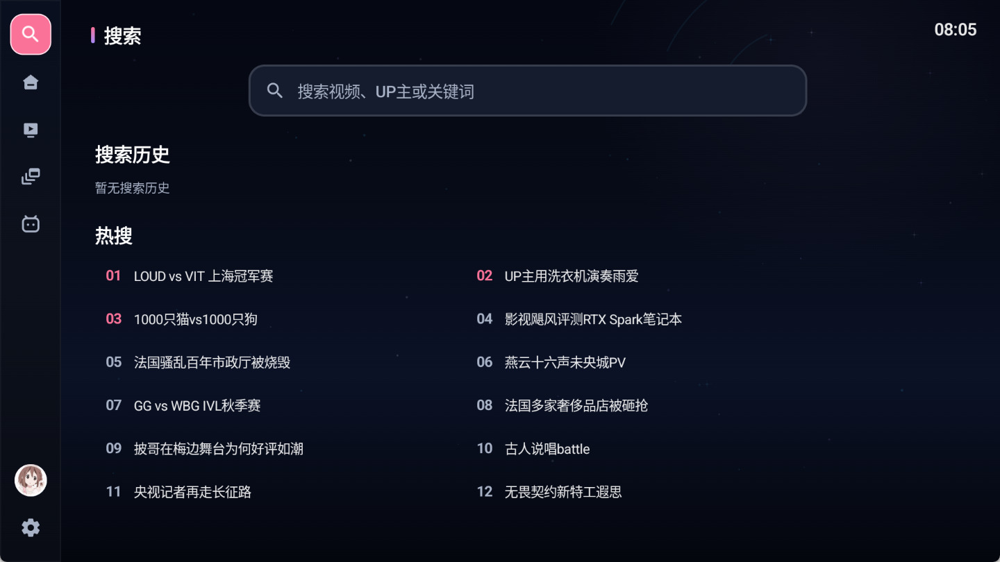</a> <strong>搜索</strong> 搜索历史与热搜入口</td>
    <td width="50%" align="center"><a href="docs/readme-images/video-feed.jpg">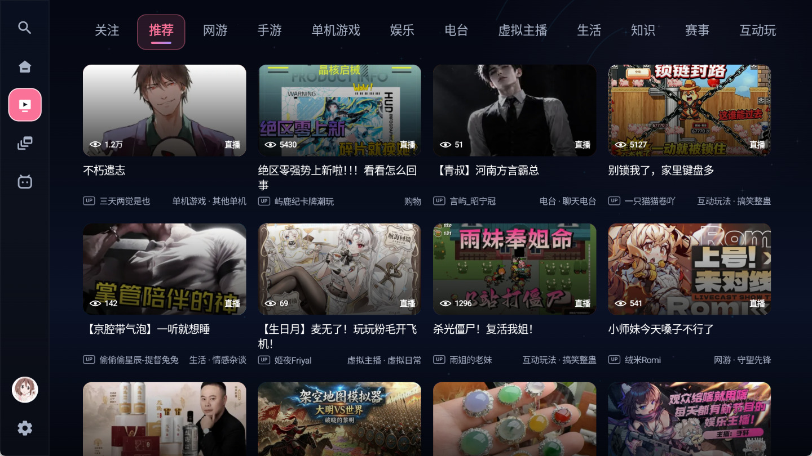</a> <strong>直播分区</strong> 按关注、推荐或分区浏览直播</td>
  </tr>
  <tr>
    <td align="center"><a href="docs/readme-images/dynamic.jpg">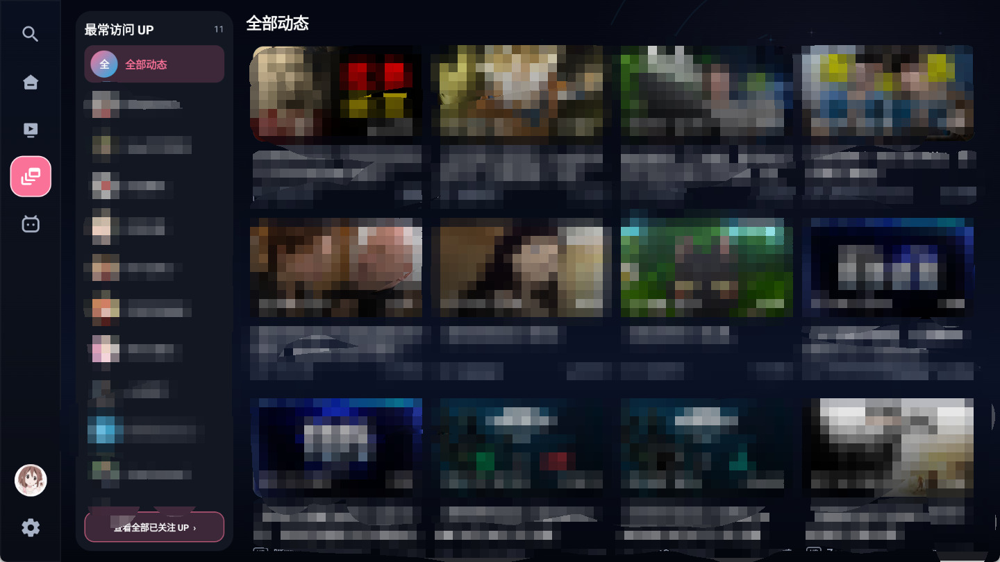</a> <strong>关注动态</strong> 集中查看关注 UP 的更新</td>
    <td align="center"><a href="docs/readme-images/up-profile.jpg">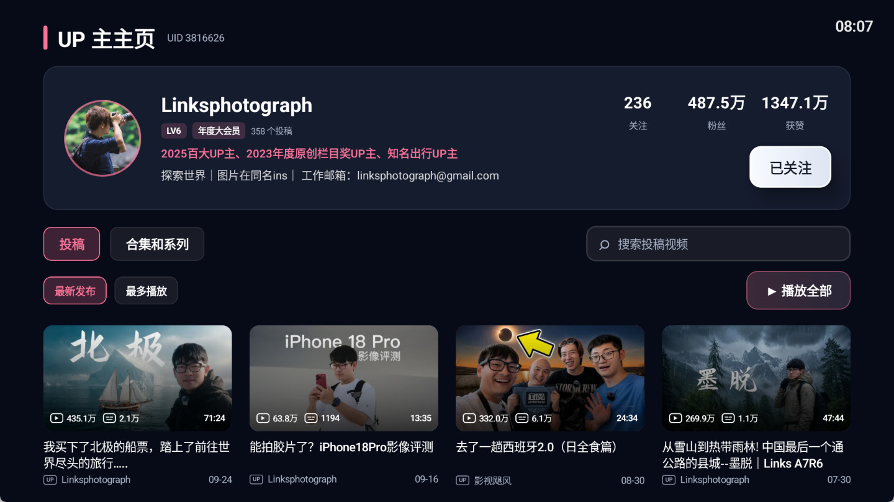</a> <strong>UP 主主页</strong> 视频、合集与系列</td>
  </tr>
</table>

### 继续观看与播放

<table>
  <tr>
    <td width="50%" align="center"><a href="docs/readme-images/my-library.jpg">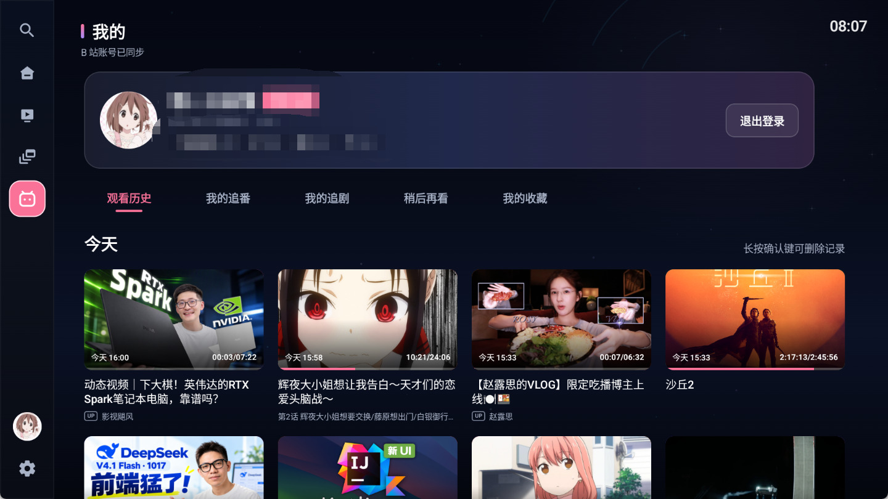</a> <strong>我的</strong> 历史、追番追剧与收藏</td>
    <td width="50%" align="center"><a href="docs/readme-images/bangumi-detail.jpg">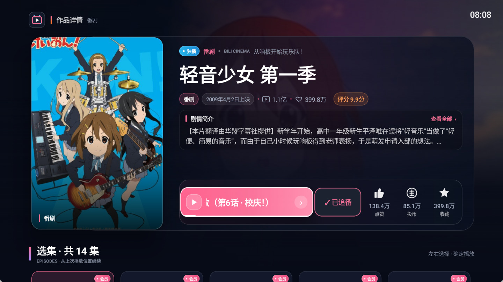</a> <strong>番剧详情</strong> 简介、选集与播放入口</td>
  </tr>
  <tr>
    <td align="center"><a href="docs/readme-images/player-danmaku.jpg">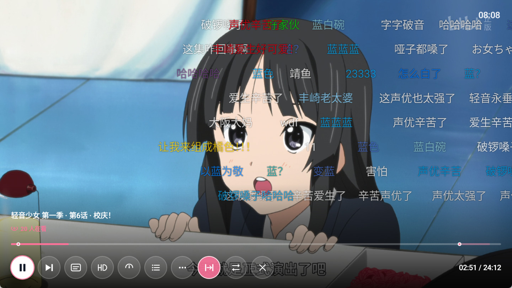</a> <strong>弹幕播放</strong> 大屏播放与遥控器控制</td>
    <td align="center"><a href="docs/readme-images/settings-about.jpg">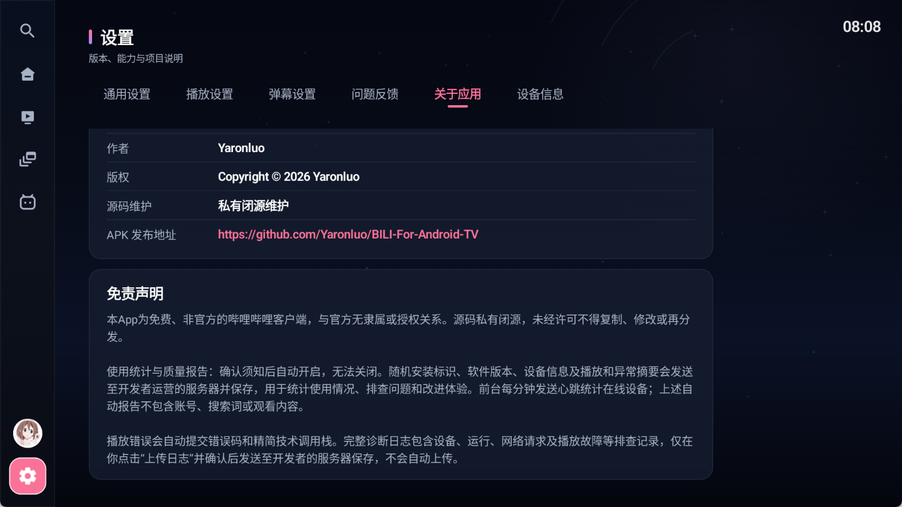</a> <strong>设置与关于</strong> 播放、弹幕、反馈与使用告知</td>
  </tr>
</table>

## 🔒 隐私与自建服务器

**项目已自建服务器。开发者运营的服务会接收并保存使用统计、质量摘要，以及你主动确认上传的完整诊断日志。** 这些数据用于统计使用情况、排查兼容性与播放问题、改进应用体验。

### 哪些数据会发送

| 数据类别 | 发送方式与内容 |
| :--- | :--- |
| 使用统计与在线心跳 | 阅读并确认当前版本使用须知后自动启用，**当前没有关闭入口**。发送随机安装标识、应用版本与渠道、Android 版本、设备品牌与型号等；应用在前台时约每分钟发送心跳，用于统计近期在线设备。 |
| 播放质量与异常摘要 | 自动发送播放实例数、首帧与缓冲等质量计数，以及崩溃类型与指纹；播放错误会附带错误码、异常类型、状态和最多 6 行精简技术调用栈，不发送完整日志。 |
| 完整诊断日志 | **仅在“设置 → 问题反馈 → 上传日志”中主动确认后发送**。包含设备、应用运行、页面与遥控器操作、网络请求耗时和状态、播放故障等排查记录，范围比自动摘要更广；失败后不会自动重传。 |

### 账号与本地数据如何保护

- **登录凭证保存在本机应用私有目录。** Cookie 用于向 B 站完成登录态请求，不发送给开发者的统计与诊断服务。请勿向他人分享 Cookie 或登录凭证。
- **自动统计不上传账号、Cookie、Token、搜索词、观看历史、视频标题、内容编号或播放地址，** 也不上传逐键输入或页面访问序列。它使用随机生成的安装标识，不使用 B 站 UID、Android ID、设备序列号、MAC 或广告标识；随机标识仍可关联同一安装，不能视为完全匿名。
- 搜索历史、本地播放进度与偏好设置保存在应用私有目录，按各自账号／访客规则管理。使用搜索、播放、观看历史同步和账号互动等功能时，应用仍会向 B 站发送相应业务请求，数据处理同时受 B 站规则约束。
- 完整诊断日志经过脱敏处理，不记录 Cookie、Token、搜索词、请求头、请求体、查询参数或播放地址；但仍包含较详细的运行上下文，请在确认收集范围后上传。也可使用“手机扫码下载”获取诊断包，再自行决定是否分享。
- 在设置中清除登录账号可删除本机保存的账号与 Cookie；“问题反馈 → 清理记录”可清除本机诊断记录。清除应用数据或卸载会删除本机应用数据，**不会自动删除服务器已接收的记录，也不会删除 B 站账号中的历史或收藏。**

### 传输、访问与保留

- 应用通过 **HTTPS** 向开发者服务发送统计与诊断数据；管理页面和报告下载需要管理员认证，完整报告不提供匿名公开下载。
- 统计服务用安装标识的 **HMAC 摘要**关联记录，不保存原始安装标识；服务本身不记录来源 IP、请求头或原始统计请求体。网络接入经过 Cloudflare 等基础设施，相关服务仍会处理连接元数据，不能据此理解为整个网络链路完全不处理 IP。
- 当前统计可关联明细通常保留 **90 天**，不含安装标识的历史汇总保留 **400 天**；用于累计安装统计的安装摘要与首次接入索引持续保留。常规备份可能额外保留已过期明细最多 **7 天**。
- 完整诊断附件通常保留 **14 天**；问题处理中、待验证或手动保留时可延长，已解决／关闭的附件通常从操作时起保留 **7 天**。附件删除后，报告摘要和处理记录仍可能保留，备份也可能额外保留最多 **7 天**。

如对数据范围有疑问，可通过[问题反馈](https://github.com/Yaronluo/BILI-For-Android-TV/issues)联系作者；公开反馈时请勿附上账号凭证、未检查的完整日志或其他私人信息。

## 📥 下载与反馈

- [下载最新 APK](https://github.com/Yaronluo/BILI-For-Android-TV/releases/latest)：适用于 Android 6.0 及以上的电视或电视盒子。
- [提交问题](https://github.com/Yaronluo/BILI-For-Android-TV/issues)：建议注明应用版本、设备型号、系统版本及复现步骤。需要日志时，可使用应用内“设置 → 问题反馈”。
- [参与讨论](https://github.com/Yaronluo/BILI-For-Android-TV/discussions)：交流使用体验与功能建议。

网页端接口可能调整；高画质、字幕、片头片尾跳过等能力依赖内容本身、账号权限和设备支持。

## 🙏 致谢

感谢以下开源项目及其维护者：

| 项目 | 用途 |
| :--- | :--- |
| [AndroidX / Jetpack](https://github.com/androidx/androidx) | Compose、DataStore、Baseline Profiles 等基础能力 |
| [AndroidX Media3](https://github.com/androidx/media) | ExoPlayer 媒体播放与播放器组件 |
| [OkHttp](https://github.com/square/okhttp) | 接口请求、媒体数据源和网络测试工具 |
| [Kotlinx Serialization](https://github.com/Kotlin/kotlinx.serialization) | 接口数据序列化与解析 |
| [Coil](https://github.com/coil-kt/coil) | Compose 图片加载 |
| [ZXing](https://github.com/zxing/zxing) | 登录和更新页面的二维码生成 |

以上项目的版权及许可归各自作者所有，本项目按照对应开源许可证使用。

## ⚖️ 闭源维护与版权

Copyright © 2026 Yaronluo。当前及后续版本的源代码采用私有闭源方式维护，适用 [Proprietary License](LICENSE)。未经版权所有者事先书面许可，不得复制、修改、公开、再发布或销售当前及后续版本的源代码。

APK 公开发布于 [BILI-For-Android-TV](https://github.com/Yaronluo/BILI-For-Android-TV)。
